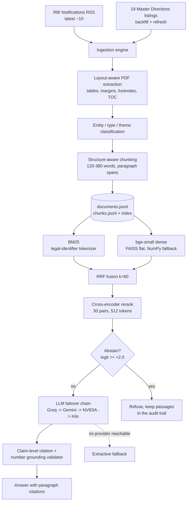

# RBIRAG — RBI Regulatory Intelligence RAG

[](https://github.com/bravo2024/rbirag/actions/workflows/tests.yml)


**Ask RBI's Master Directions a question and get an answer that cites the
paragraph, the instrument and the page — or an explicit refusal.**


RBIRAG is a retrieval-augmented generation system over **RBI's complete Master
Directions catalogue and the latest notifications**. It polls the RBI
Notifications RSS feed, backfills all 19 Master Directions listings, parses the
official PDFs layout-aware, classifies every instrument by **who it binds**
(commercial bank vs NBFC/HFC vs others), and answers with **hybrid retrieval
(BM25 + dense + cross-encoder)** and **audit-trail citations** — or abstains.

After RBI's Nov-2025 consolidation into entity-wise *Directions, 2025* (~9,445
circulars withdrawn), "which document applies to *my* entity, at which
paragraph, as of when?" is the core question. Both entity columns run off the
same corpus with one toggle.

> ⚖️ Informational tool built on official RBI texts (rbi.org.in). Not legal advice.

## At a glance

| | |
|---|---|
| **Corpus** | 398 instruments · 14,186 passages · 16,016 pages (synced 2026-10-20) |
| **Retrieval** | BM25 (legal-identifier tokenizer) + bge-small-en-v1.5 dense (FAISS) → RRF k=60 → cross-encoder rerank |
| **Gold set** | recall@5 **100%** (23/23) · MRR **0.836** · nDCG@10 **0.837** |
| **Held-out set** | recall@5 **12/12** · MRR **0.819** |
| **Abstention** | refused **10 of 11** out-of-scope probes at a calibrated +2.0 logit threshold |
| **Answer layer** | multi-provider LLM failover, claim-level citation validation, number grounding, extractive fallback |
| **Tests** | 120 passing (`pytest tests`) |

## Quickstart

```bash
git clone https://github.com/bravo2024/rbirag.git && cd rbirag
python -m venv .venv && source .venv/bin/activate     # Windows: .venv\Scripts\activate
pip install -r requirements.txt
streamlit run app.py
```

The corpus and indexes are committed, so the app runs on a fresh clone with no
API key and no build step. Answers use the anonymous **Kilo** free gateway; if
every provider is down the app returns the retrieved passages with citations
(**extractive mode**). To rebuild the corpus from RBI instead:

```bash
python scripts/sync.py --source both      # RSS + backfill listings
python scripts/build_index.py --full      # BM25 + dense (downloads bge-small ~130 MB)
```

Optional extras (FAISS, the LangChain layer, Kaggle CLI, RAGAS): `pip install -r requirements-extras.txt`.

## Architecture



Every answer carries the retrieved passages, their scores, page numbers and
official `rbidocs` links; the **Audit** tab exports the full trace as JSONL.

## Contents

- [What this delivers](#what-this-delivers-mapped-to-the-brief) · [Corpus status](#corpus-status-this-build) · [Quickstart](#quickstart) · [Components](#the-components)
- [Evaluation](#evaluation) — retrieval, encoder swap, 120-question draft set, RAGAS answer eval
- [Deployment](#deployment-streamlit-cloud) · [Design decisions & honest limitations](#design-decisions--honest-limitations) · [Roadmap](#roadmap-ideas)

> The Python package is named `regintel` (the project's original working name);
> `RBIRAG` is the product name used in the UI and documentation.

---


## What this delivers (mapped to the brief)

| Requirement | Implementation |
|---|---|
| **1. Poll & auto-update from the live RBI RSS feed** | `regintel/rss.py` + `regintel/ingest.py`: every poll diffs the feed against a persisted state of page ids; new items are fetched, parsed, chunked and indexed. UI: *Check RSS* / *Sync now (feed + listings)* / optional 2-minute auto-sync. CI: nightly `sync-rbi` workflow commits refreshed artifacts. |
| **2. Layout-aware parsing + hybrid retrieval (dense + BM25 + cross-encoder rerank)** | `regintel/extract.py` (PyMuPDF: reading order, ruled-table detection, repeated header/footer removal, footnote separation, TOC skipping, dehyphenation) + `regintel/index/` (custom BM25 with RBI-reference-aware tokenizer, bge-small dense index, RRF fusion, ms-marco cross-encoder rerank). |
| **3. Institution filter (NBFC vs Bank)** | `regintel/classify.py` tags every instrument with canonical entities from its title (authoritative) or its "To, All …" addressee block; cross-cutting docs are marked `broad` and always pass. The UI's institution view maps NBFC→{NBFC, HFC}, Bank→{commercial banks, authorised dealers}. Every tag carries evidence, shown on the citation card. |
| **4. Full runnable code: ingestion, retriever, Streamlit UI with live updating, audit-trail citations, side-by-side inspection** | `scripts/sync.py` (CLI), `app.py` (Ask / Circulars / Compare / Audit), `data/` artifacts committed so a fresh clone runs without any crawl. |
| **5. Evaluation (retrieval + answer-level RAGAS + abstention)** | `scripts/eval_retrieval.py` (recall@k, MRR, nDCG@10), `scripts/eval_answers.py` (per-answer RAGAS + pipeline mechanics + second-judge agreement, with per-call model provenance), `scripts/eval_abstention.py` (out-of-scope refusal vs false abstention) — artifacts in `evals/results/`. |

## Corpus status (this build)

- **398 instruments / 14,186 passages / 16,016 pages** (synced 2026-10-20) — the complete current Master Directions catalog: 385 directions and guidelines backfilled from all 19 RBI listings (commercial banks, NBFCs, co-operative banks, small-finance and payments banks, RRBs, LABs, AIFIs, ARCs, CICs, PPI issuers, plus the cross-cutting financial-market, FEMA, payment-systems, consumer-protection and financial-inclusion pages) + 13 notifications mined from the RSS feed (latest: the 19 Oct 2026 UAPA/UNSC update and two Miscellaneous amendments).
- Entity tags (a document can carry several): co-operative banks 71, commercial banks 59, small-finance banks 52, NBFC family 45, local-area banks 37, RRBs 35, payments banks 34, AIFIs 26, authorised dealers 21, CICs 6, ARCs 6, PPI issuers 4; 34 cross-cutting instruments are deliberately untagged (`entity_scope=broad`, they pass every institution view).
- Instruments dated 2013→2027 (the 2025 consolidation carries the original effective dates forward).

## Quickstart

```bash
python -m venv .venv && .venv/Scripts/activate      # or: source .venv/bin/activate
pip install -r requirements.txt
pip install -r requirements-extras.txt               # FAISS + LangChain + Kaggle CLI (optional)

# 1) corpus — either use the committed artifacts, or rebuild from RBI:
python scripts/sync.py --source both                 # RSS + backfill listings
python scripts/build_index.py --full                 # BM25 + dense (first run downloads bge-small ~130 MB)

# 2) run
streamlit run app.py
```

No LLM keys are required: answers work via the anonymous **Kilo** free gateway,
and if every gateway is down the app returns the retrieved passages with
citations (**extractive mode**). Keys for Groq / NVIDIA / Gemini are read from
`.env` (see `.env.example`); with keys present the failover order is **Groq →
Gemini → NVIDIA → Kilo**. Retrieval and citations never depend on an LLM.
The keyless Kilo gateway is called as itself — with no client-attribution
headers (an earlier build sent Kilo's own `HTTP-Referer` / `X-Title` to pass as
its client; removed. `REGINTEL_KILO_ATTRIBUTION=1` opts back in, default off).
Checked 2026-10-17 without those headers: the gateway's `/models` list and a
chat completion both answered, so keyless mode still works.

## The components

### Ingestion engine (`regintel/`)
- `rss.py` — feed parsing + seen-state diffing (the feed only carries the ~10 most recent items; state makes polling lossless).
- `backfill.py` — crawls all 19 RBI Master Directions listings (30 pages: 8 cross-cutting + 11 Department of Regulation + 11 Department of Supervision) and resolves each view page to its consolidated PDF.
- `http.py` — browser UA, 1.2 s throttle, retries with backoff, on-disk page cache.
- `fetch.py` — notification page → canonical PDF on `rbidocs.rbi.org.in` + the RBI reference (`RBI/2026-27/293`).
- `extract.py` — layout-aware text extraction (why it matters: naive dumps interleave running letterheads, page numbers, ruled tables and dot-leader TOC lines into the body text and wreck both chunking and retrieval).
- `classify.py` — entity, instrument type, theme and content-class tags, each with evidence.
- `chunk.py` — structure-aware chunking: builds the CHAPTER / numbered-paragraph / decimal / (a)(i) tree and packs it into ~120–380-word passages, never cutting a clause that has sub-clauses to split on; oversized leaves split at sentence boundaries.
- `ingest.py` — the pipeline (run under an inter-process lockfile, `synclock.py`: a second concurrent sync — another session, or the CI job — skips with a message instead of double-appending; a crashed run's lock expires after 30 min): `poll → diff → download → extract → classify → chunk → append → rebuild BM25 + incrementally append dense vectors → manifest`, plus two maintenance passes: `refresh_backfill()` re-checks each listing's “Updated as on” date and re-ingests changed pages as new versions (old versions flip to `superseded`), and `link_amendments()` links amendment notices to their parent Directions by title. Idempotent per RBI page id; failures are per-document and non-fatal.

### Retrieval (`regintel/index/`)
- **BM25** over a sparse weight matrix with a tokenizer that keeps legal identifiers whole (`5.2.1`, `DOR.STR.REC.51/21.04.048/2024-25`, `RBI/2026-27/293`, `2025-26`).
- **Dense** — `BAAI/bge-small-en-v1.5` (query-prefixed), float16 storage, **FAISS `IndexFlatIP`** exact cosine search (masked queries stay exact: full flat scan + filter) with a byte-identical **NumPy fallback** when faiss is absent (`REGINTEL_DENSE_BACKEND=numpy` forces it; equivalence pinned by `tests/test_dense_faiss.py`).
- **Fusion** — Reciprocal Rank Fusion (k=60) over both arms, text-hash dedupe (collapses byte-identical chunks within one result set; it never merges near-identical entity versions), then **cross-encoder rerank** (`ms-marco-MiniLM-L-6-v2`) over the top 30 (`REGINTEL_RERANK_DEPTH`). Passages are fed whole — the only truncation left is the model's own 512-token pair limit (`REGINTEL_RERANK_MAX_LENGTH`); see Evaluation for the measured effect of this fix. Every query's audit trail reports per-stage `timings_ms` (bm25 / encode / dense / fuse / rerank).
- **Filters** — institution view, instrument type, theme, *issued since* (uses the doc's `as_of` currency date), *include withdrawn / superseded*. Cross-cutting instruments always pass the institution filter.
- **Abstain** — if the best rerank logit is below the threshold (`REGINTEL_ABSTAIN`, default **+2.0**, calibrated 2026‑10‑17: gold-set top passages ≥ 3.42, 10 of 11 out-of-scope probes ≤ +1.64, one overlap at +4.0) or nothing passes the filters, the query is **refused at retrieval level**: in the app's default *refuse low-confidence queries without the LLM* mode the model is never asked (the closest passages stay visible in the audit trail); with the mode off, the LLM is asked with an explicit caution to abstain unless the passages directly answer. Threshold and mode are live in *Retrieval settings*; the effective value is recorded in each query's trace.

### Vector store & LangChain layer (`regintel/lc/`, extras)
- **FAISS** is the dense backend, and `scripts/build_lc_store.py` persists a LangChain **FAISS vector store** (`data/index/lc_faiss/`) over the same vectors for LangChain-native use (similarity search, MMR, `as_retriever()`).
- **`RBIRAGRetriever`** exposes the full hybrid engine — not a plain vector lookup — as a LangChain retriever returning Documents with complete citation metadata.
- **`regintel.lc.lc_answer`** is an LCEL chain (`retriever → prompt → chat models with with_fallbacks() → citation validator + number grounding`) whose output contract is identical to the native path; both share `regintel/answer.py`, so quality checks never fork.
- Install via `requirements-extras.txt`; every piece degrades gracefully when the extras are absent.

### Answer layer (`regintel/answer.py`, `regintel/llm.py`)
The LLM must return strict JSON — an answer plus claim-level citations
(`[C3]`). Every claim is validated against the numbered passages; unresolvable
claims are dropped and counted, and each surviving claim is **number-checked**
(the agenticresearch eval rule — every number in the answer must appear in
its source): a number absent from the cited passage is flagged in the UI.
The response object keeps the full citation cards (title, reference, date,
paragraph, page range, scores, official links), so the UI can render the
**audit trail** under every answer. A reply truncated mid-JSON (token budget
exhausted) is retried once with a doubled budget — `parse_retries` in the
response records when that happened. With no provider available the same
structure is filled extractively.

Failover chain (keyed providers lead; all optional): **Groq → Gemini free tier
→ NVIDIA Build → Kilo (keyless)**. Model ids are discovered live from each
provider's `/models` endpoint (cached 10 min, ranked strongest-first, Gemini
locked to Flash/Flash-Lite), and a failing model is parked — 30 min for
permanent errors, 10 min after a timeout, 60 s after a rate limit — so one
dead endpoint cannot slow the next answer. LLM calls pass through a SQLite
disk cache (`data/cache/llm.sqlite`) for reproducibility.

### UI (`app.py`)
- **Ask** — chat over the corpus with the institution toggle and an optional **in-force-on (point-in-time)** date; each answer shows mode (grounded LLM / extractive / abstained), model, latency, validated claims, and an expandable audit trail with per-passage citation cards and retrieval ranks (`bm25_rank`, `dense_rank`, `rerank`). Citation cards show a paragraph span (“Paras 4.2–4.4”) when the passage covers a contiguous numeric run.
- **Circulars** — browse/search every instrument; metadata, entity/theme chips, extraction provenance (source, sha256) and the full parsed text page by page, with links to the official PDF.
- **Compare** — side-by-side two instruments with **paragraph-overlap highlighting** (≥62% similar, token-indexed matching) — e.g., the bank vs NBFC version of the same mandate, or a 2025 consolidation vs its 2026 amendment.
- **Audit** — every query since deployment: filters, retrieved chunk ids, scores, answer settings; exportable as JSONL.
- **RBI updates** (sidebar) — last feed poll, *Check RSS*, *Sync now (feed + listings)* (with progress), optional 2-minute auto-sync fragment that ingests new items automatically.

### CLI
```bash
python scripts/sync.py --source rss|backfill|both [--limit N] [--refresh] [--no-index]
python scripts/sync.py --rebuild            # full dense re-encode, no fetch
python scripts/recompute_status.py          # re-derive status/effective dates from stored pages
python scripts/build_index.py [--full|--bm25-only]
python scripts/rechunk.py                   # re-derive chunks from stored text
python scripts/add_para_spans.py [--write]  # add para_end metadata; verifies text, no re-encode
python scripts/eval_retrieval.py [--k 5] [--file evals/queries_holdout.jsonl --tag holdout]
python scripts/build_eval_set_v2.py --force  # regenerate the draft 120-question set (overwrites review edits)
python scripts/eval_v2.py [--no-rerank|--only unanswerable|--reviewed-only]  # category-aware v2 eval
python scripts/eval_encoder_ab.py --a data/index --b <other-index> --files evals/queries.jsonl evals/queries_holdout.jsonl [--rerank]
python scripts/eval_judge_probe.py          # timed JSON-compliance probe for judge selection
python scripts/eval_answers.py [--limit N] [--strict-pin]  # RAGAS metrics + mechanics + judge agreement
python scripts/eval_answers.py --file evals/eval_set_v2.jsonl --category answerable --limit 5 --tag v2_ragas_draft5
powershell -NoProfile -ExecutionPolicy Bypass -File scripts/run_ragas_bg.ps1 -Cores 2 -Tag v2_ragas_full_draft  # background, CPU-limited draft run
python scripts/eval_abstention.py [--file evals/queries_negative_holdout.jsonl --tag holdout]  # out-of-scope refusal vs false abstention (app gate emulated)
python scripts/build_lc_store.py [--smoke "kyc"]   # persist the LangChain FAISS store
python scripts/kaggle_build_index.py        # rebuild the index on a free Kaggle GPU
python -m pytest tests -q                   # offline tests (retrieval, LLM registry, LangChain)
```

### Background, CPU-limited RAGAS

Windows has no cgroup-style CPU quota. `scripts/run_ragas_bg.ps1` uses the
practical equivalent: it starts the answer eval with `BelowNormal` priority and
pins it to `N` logical CPUs (`-Cores`, default 2; affinity mask 3). This caps
the Python process at those cores but does not enforce a percentage of total
machine CPU.

```powershell
# Full answer-bearing draft set: 60 answerable + 20 amendment + 20 as-of (100 rows)
powershell -NoProfile -ExecutionPolicy Bypass -File scripts/run_ragas_bg.ps1 `
  -Cores 2 -Tag v2_ragas_full_draft

# Add the second faithfulness judge (more API calls/time)
powershell -NoProfile -ExecutionPolicy Bypass -File scripts/run_ragas_bg.ps1 `
  -Cores 2 -Tag v2_ragas_full_draft -Agreement
```

Logs and the PID/affinity record go to
`evals/results/ragas_<tag>_<stamp>.log` (`.err`, `.meta`). Use `-DryRun` to
print the command, `-Limit N` for a sample, or `-Agreement` to include judge 2.
The unanswerable 20 rows are excluded by default because they belong to the
abstention harness, not RAGAS. A full draft run can take hours because judge
calls are serial and provider rate limits are absorbed by failover; the run is
resumable by scoring the saved `answers_*.json`.

### Kaggle GPU index builds (`kaggle/`, `scripts/kaggle_build_index.py`)
The same index can be rebuilt on a free Kaggle GPU: the script stages the code +
corpus as a private Kaggle dataset, pushes `kaggle/gpu_index_build/kernel.py` as
a GPU kernel, waits for it, downloads the artifacts to `kaggle/out/` and verifies
them against the local build. Verified runs (2026-10-17, Tesla T4, `gpu_report.json`
status ok):
- **v1 build** (82 docs / 3,507 chunks, 96 s wall clock): against the local CPU
  build — BM25 values 378,920/378,920 bit-identical (same sparsity pattern),
  `bm25_vocab.json` byte-identical, dense vectors 99.4% of fp16 elements
  bit-identical with the rest 1-ULP CPU/CUDA rounding (float64 cosine min
  0.99999999) — the `cos_min > 0.999` equivalence gate passes.
- **full-catalog build** (395 docs / 14,181 chunks, 202.7 s wall clock,
  `v1-53b832bb59`): encoded on the GPU by the same kernel (the corpus is never
  re-encoded locally); verified structurally — 14,181 × 384 fp16 rows match the
  chunk count exactly, unit row norms (min 0.9999).
Needs `pip install kaggle` + `~/.kaggle/kaggle.json`.

## Evaluation

`evals/queries.jsonl` holds 23 curated questions with gold document ids across
both institution views, the live-RSS layer, and the expansion categories
(co-operative banks, RRBs, FEMA, PPI issuers, the 2026 supervisory wave).
`scripts/eval_retrieval.py` reports document-level recall@k, MRR and nDCG@10
and writes a JSON result file to `evals/results/`. Latest run (2026-10-17,
395 docs / 14,181 passages, rerank on, full-passage rerank inputs):
**recall@5 = 23/23 = 100%, MRR = 0.836, recall@10 = 100%, nDCG@10 = 0.837**
(`retrieval_2026-10-17T19-03-15_afterfix.json`).

A **held-out set** (`evals/queries_holdout.jsonl` — 12 questions authored
after the defaults were frozen, gold ids resolved from titles only, never used
for tuning): **recall@5 = 12/12 = 100%, MRR = 0.819, nDCG@10 = 0.866**
(`retrieval_2026-10-17T19-05-57_holdout.json`). It includes an unfiltered
probe — “what must banks do to detect and report fraud incidents”, with the
Commercial Banks version as gold — checking that with no institution filter the
right entity version still outranks its nine siblings (it did, RR = 1.0).

After the 2026-10-20 RSS sync (398 docs / 14,186 chunks) a rerank-off sanity
check on the same 23 questions reproduced the earlier RRF-only baseline:
recall@5 = 21/23, recall@10 = 23/23, MRR = 0.779, nDCG@10 = 0.796
(`retrieval_2026-10-20T00-44-08.json`).

Rerank ablations (recall/MRR from the tuning session on the same gold set; the
depth-30 default was kept):

| rerank setting | recall@5 | MRR |
| --- | --- | --- |
| depth 50, 512-token cap | 23/23 | 0.847 |
| **depth 30, 512-token cap (default)** | **23/23** | **0.869 at tuning → 0.836 after the full-text fix** |
| depth 30, 384-token cap | 20/23 | 0.802 |
| depth 50, 384-token cap | 20/23 | 0.780 |
| no rerank (RRF only) | 21/23 | 0.779 |

### Encoder swap check (2026-10-20)

The same 14,186-chunk corpus and both query sets were re-encoded with
`vivekkopthsd/hinglish-st-33m` (384-d, 192-token cap, no query prefix) and
compared with the bge index. Document-level metrics, bge → hinglish
(recall@5 gold / held-out; MRR@5 gold / held-out):

| arm | recall@5 (gold / holdout) | MRR@5 (gold / holdout) |
| --- | --- | --- |
| dense-only | .870 / .917 → .739 / .833 | .768 / .736 → .570 / .561 |
| hybrid RRF | .913 / .917 → .913 / .750 | .797 / .688 → .717 / .653 |
| hybrid + rerank | 1.000 / 1.000 → .957 / .917 | .844 / .833 → .804 / .792 |

Hinglish loses on every arm and set; rerank recovers much of the gap but does
not close it. The default stays `BAAI/bge-small-en-v1.5`. This measures English
queries only — it does not test Hinglish query capability, which would need a
Hinglish query set (or a bilingual encoder). Artifacts:
`evals/results/encoder_ab_2026-10-20T02-15-58_bge_vs_hinglish_rerank.{json,md}`;
the Hinglish index was built on Kaggle CPU (`kaggle/out_hinglish/`).

### Draft 120-question evaluation set (2026-10-20)

`evals/eval_set_v2.jsonl` adds **60 answerable, 20 point-in-time, 20 amendment
and 20 unanswerable** questions. Every row is `review_status="draft"`: the
questions were authored from document titles and notification text, but the
gold labels still need domain review. Review protocol and schema:
`evals/eval_set_v2_README.md`; editable sheet:
`evals/eval_set_v2_review.csv`.

What it adds over the 23-question set:

* **Point-in-time** — ten documents × (before effective date, on/after it).
  The harness checks the probe document *and* that no returned document has an
  `effective_from` later than the requested date (`future_leaks`).
* **Amendment provenance** — questions whose gold includes both the October 2026
  notification and the Direction it amends, not just the parent.
* **Abstention** — 20 out-of-regulator and in-domain trap questions.

Draft baseline (retrieval with rerank off; abstention with rerank on):

| slice | result |
| --- | --- |
| answerable + amendment, n=80, rerank off | recall@5 **.950**, MRR@5 **.795**, recall@10 **.975**, nDCG@10 **.816** |
| answerable + amendment, n=80, rerank on | recall@5 **.925**, MRR@5 **.812**, recall@10 **.963**, nDCG@10 **.826** |
| — commercial banks, n=47 (rerank off / on) | recall@5 **1.000 / .979** |
| — NBFC, n=30 (rerank off / on) | recall@5 **.867 / .833** |
| as_of, n=20 | **20/20**, 0 false includes/excludes, **0 future leaks** |
| unanswerable, n=20 | abstention **18/20 = .900** |

The four retrieval misses are all generic NBFC queries (credit risk management,
credit facilities, governance, credit information reporting); two are outside
the top 10, two are at rank 7. The title appears in the preliminary passage,
not throughout the document, and generic topic queries match several sibling
directions; this is a real retrieval weakness, not a label error.

Rerank is a separate warning: it does **not** rescue any of the four misses and
adds two top-5 misses of its own — `v2-a18` (board governance) and `v2-a34`
(NBFC income recognition/asset classification), with gold at rank 10 and rank 8
respectively, so still recall@10 hits. It slightly improves MRR and nDCG but lowers recall@5 from .950
to .925. On the 23-question set rerank was a clear win; on this broader draft it
is not. Do not change the default from draft labels alone; review the set, then
investigate rerank depth and the generic-query failure mode.

The two abstention misses (SEBI disclosure and the October 2026 RBI press
release) are topically nearby RBI passages that do not actually answer the
question. These are findings, not questions to rename until they pass. Artifacts:
`evals/results/eval_v2_2026-10-20T03-39-35_draft_norerank3.{json,md}`,
`evals/results/eval_v2_2026-10-20T04-05-03_draft_rerank.{json,md}` and
`evals/results/eval_v2_2026-10-20T03-44-01_draft_unanswerable_rerank2.{json,md}`.
**Draft numbers are not a verified benchmark and should not be compared
directly to the 23-question gold set.**

**RAGAS smoke.** `scripts/eval_answers.py` now accepts the v2 schema
(`--file`, `--category`, `--reviewed-only`). On the first five answerable
commercial-bank rows (draft labels, not reviewed):

| metric | mean | judged |
| --- | --- | --- |
| faithfulness | **0.928** | 5/5 |
| answer_relevancy | **0.809** | 5/5 |
| llm_context_precision_without_reference | **0.785** | 5/5 |

All five answers were LLM mode (no abstain/extractive), and the gold document
was in context 5/5. The citation validator dropped 0 claims, but number-grounding
flagged 4 of 12 (grounded rate 0.667), all four on the investment-portfolio
answer. Judge agreement on faithfulness was n=5, mean |Δ| 0.068, r=0.298 — far
too small to interpret. One row (savings-deposit interest) had context
precision 0.25 despite the gold document ranking first: RAGAS context precision
scores every retrieved passage for relevance, not just the gold hit.
The sample is all commercial-bank rows and is a wiring/quality smoke, not a
full-set RAGAS benchmark; the remaining answerable rows are still draft labels.
One of the five answers fell back to `gemini/gemini-3.5-flash` (the pin is
`groq/openai/gpt-oss-120b`), so it is a mixed-model smoke; the report records
the full served-model census. Artifact:
`evals/results/answer_eval_2026-10-20T16-51-39_v2_ragas_draft5.{json,md}`.

Two review-era corrections to earlier claims:

1. **Rerank inputs.** The cross-encoder previously saw only the first 2,000
   characters of a passage (~300 words) while the median passage is ~340 words.
   The fix feeds whole passages; on the gold set MRR moved 0.869 → 0.836 (one
   co-op KYC query’s gold chunk fell from rank 1 to 4, while a securitisation
   query improved and two others moved marginally) and recall stayed 100% on
   both sets. The residual truncation is the model’s hard 512-token pair limit,
   which cannot be raised — `ms-marco-MiniLM-L-6-v2` has 512-position
   embeddings and errors beyond it.
2. **Latency.** The 6.8 s figure previously quoted here was a best-case idle
   measurement. Re-measured on this 4-core laptop under real background load,
   the same 30-pair cross-encoder step takes ~8–13 s (median 10.3 s / 10.9 s
   across the two runs above). Profiling (re-checked 2026-10-17, interleaved A/B, 5 queries x 3 reps,
   scores identical to <1e-5): sentence-transformers 5.x already runs
   `predict` under `torch.inference_mode` and length-sorts the batches, so
   manual sorting adds nothing; batch 8/16/32 and 3 vs 4 torch threads were all
   within the machine's own run-to-run noise (7.5–20 s per 30-pair call), and
   the current 16 / 4 was never beaten, so nothing changed. Earlier: torch threading (4) and batch size
   (16–32) are already optimal; int8 dynamic quantization preserves the ranking
   (top-30 identical on a 30-passage probe) but measured no faster on this CPU;
   the ONNX Runtime route is blocked by a dependency conflict (`optimum-onnx`
   caps `transformers<4.58`; this environment runs 5.x) and stays roadmap.
   Cheaper options: `REGINTEL_RERANK_DEPTH=20`, or disable rerank entirely
   (~65 ms, recall 21/23).

This is a retrieval smoke-eval, not a benchmark of legal correctness — the LLM
layer is validated separately by the citation validator (claims that don't
resolve to retrieved passages are dropped) and the number-grounding check
(numbers in a claim must appear in its cited passage).

### Answer-level evaluation (RAGAS)

`scripts/eval_answers.py` runs the product pipeline end-to-end on all 23 gold
questions, then scores the LLM-mode answers with RAGAS — faithfulness, answer
relevance, and LLM-judged context precision without reference — while recording
each call's serving model. Both roles are pinned (`--answer-pin` / `--judge-pin`;
the judge pin was chosen with the timed JSON-compliance probe in
`scripts/eval_judge_probe.py`), and every judge call routes through the product's
own failover chain. Latest full run 2026-10-17
(`evals/results/answer_eval_2026-10-17T19-38-16_postfix.{json,md}`) — **its header
names `groq:openai/gpt-oss-120b` as answerer and judge, but that was only the
pin: it was served mostly by `gemini-3.5-flash-lite` as both answerer and judge
(self-judged), so read these as lite-tier numbers, not gpt-oss numbers. The
strict-pin rerun has since landed — see below.**

| metric | mean | judged |
| --- | --- | --- |
| faithfulness | 0.935 | 19/19 |
| answer_relevancy | 0.797 | 19/19 |
| llm_context_precision_without_reference | 0.781 | 19/19 |

Same run: gold document retrieved 23/23; modes 19 LLM / 4 abstain / 0 extractive;
65 atomic claims (0 dropped by the citation validator, 9 flagged by
number-grounding → 0.862 grounded); median latencies 9.9 s retrieval / 17.8 s
answer / 31.7 s end-to-end.

**The second-judge agreement figure from that run (r = 0.999, mean |Δ| = 0.001) is
invalid and has been withdrawn.** Root cause (confirmed): `llm.chat` looked the
cache up across *every* model in the failover order, so judge 2 — pinned to
`gemini-3.7-flash` (which was out of free-tier quota) — received the reply that
judge 1 had cached from its `gemini-3.5-flash-lite` fallback for the same
prompt; the two "judges" were one model reading its own cache (18 of 19 scores
identical; the whole LLM cache holds only 22 `gemini-3.7-flash` rows against
343 for the lite tier). A second bug stacked on it: the eval script handed the second judge's pin to the
harness as the raw string `"gemini:gemini-3.7-flash"` instead of a (provider, model)
pair, so the pin was never applied at all. Fixed: a pinned call now reads only the pinned model's own
cache entry, and `--strict-pin` forbids live fallback altogether (a call the
pinned model cannot serve fails instead of silently using another model).
`eval_answers.py` now records the serving provider/model of every answer and
every judge call, prints the served-model census in the report header, and
computes judge agreement only over records where the two judges were served by
different models — otherwise it prints “not computed: same model served both
judges”.

Post-fix smoke (n = 2, `--strict-pin`, `answer_eval_2026-10-17T21-56-27_smoke_strict3.json`):
answers served by `gemini-3.5-flash-lite`, judge 1 by `nvidia/nemotron-3-super-120b-a12b`,
judge 2 by `gemini-3.5-flash-lite` — different models, so agreement was computed
(n = 2, mean |Δ| = 0.133; far too small to mean anything). The default pins could
not be honoured that day: Groq returned HTTP 429 under `--strict-pin` (the run
failed loudly instead of falling back) and `gemini-3.7-flash` was out of free
quota.

**Full strict rerun** (2026-10-18 00:33,
`answer_eval_2026-10-18T00-33-57_strict_full.{json,md}`), pinned to the models
that could actually serve that day: answers
`nvidia-build:nvidia/nemotron-3-super-120b-a12b` (served 19/19), judge
`gemini:gemini-3.5-flash-lite` (118 calls), judge 2
`kilo-free:poolside/laguna-s-2.1:free` (51 calls). **Faithfulness 0.925 (19/19)
and answer relevancy 0.814 (19/19)**; context precision scored only 2 of 19
(the pinned judge could not serve the rest — left unscored, never substituted);
4 of 23 answers degraded to extractive (the pinned answer model failed on those);
medians 8.8 s retrieval / 37.8 s answer / 50.5 s end-to-end. Judge agreement —
the first computed over genuinely different served models — is **r = 0.322 over
12 scoreable pairs** (mean |Δ| = 0.042): real cross-model corroboration is
modest, which is the point of reporting it.

Honest provenance — free-tier serving is a lottery; the metrics describe **what
the product achieved on free-tier keys in this window**, and each artifact's
census records who actually served:

- **Answers**: only 3 of 23 were served by the pinned `openai/gpt-oss-120b`
  (Groq was rate-limited throughout); 19 went to `gemini-3.5-flash-lite` and
  one to the NVIDIA fallback tier.
- **The 4 answer-level abstentions were all served by the lite tier** — on
  numeric-detail questions (an exact provisioning percentage, an NAV threshold)
  the passages don't spell out, it refused rather than guess; retrieval had
  found the gold document in all 23 cases (retrieval never false-abstained).
- **Judging**: the pinned judge served only 7 of 171 fresh stage-2 scoring calls
  — the lite tier carried the rest, so faithfulness above is the lite model
  grading answers that the lite model mostly wrote (the strict rerun below
  separates the roles). The withdrawn figures: the earlier r = 0.999 was a cache
  artifact, and r = 0.715 predates the cache fix; the first valid cross-model
  number is the strict rerun's **r = 0.322 (n = 12)**. The mechanical validators
  and the held-out sets are the anti-overclaiming anchors.

Abstention (`scripts/eval_abstention.py`, artifact
`evals/results/abstention_2026-10-17T20-50-24.json`, app gate emulated):

- **Out-of-scope (11 probes): 10 refused at retrieval level** — their best
  logits sit at +1.64 and below, under the +2.0 gate, so no LLM is asked.
- **The one overlap case reached the model**: “What is SEBI's framework for
  insider trading…?” scores +3.996 (above the lowest in-scope top, +3.42) and,
  served by the NVIDIA fallback in this window, was answered from a passage that
  only mentions SEBI in passing — a miss; an earlier window serving the same
  query through the lite tier refused it. This is the documented edge of the
  calibration: where the ranges overlap, the answer layer is the only defence,
  and its behaviour varies with whichever free model is serving.
- **False abstention on the 23 in-scope questions: 4/23 (17.4%)** — all four on
  numeric-detail questions the passages don't spell out, all four served by the
  lite fallback tier; retrieval never false-abstained (0/23).

**Held-out out-of-scope check.** The +2.0 threshold was calibrated on the same 23
gold + 11 negative questions it was reported on, so those numbers above are not a
test of it. `evals/queries_negative_holdout.jsonl` holds 18 new negatives written
before looking at any score and run once at the unchanged threshold (never
retuned on): in-domain traps (today's repo rate / MPC decisions, an RBI press
release, a Governor speech), SEBI (LODR, mutual-fund expense ratio, insider-trading
window), IRDAI, PFRDA, GST, income tax, MCA / Companies Act filing, a
non-existent RBI circular number, FDIC / UK PRA / EU DORA, and two trivia
(`evals/results/abstention_2026-10-17T21-26-55_holdout.json`). Result: **17/18
refused at retrieval level, 1 answered (94.4%)**. The miss is the press-release
probe (“summarise the RBI press release announcing the latest Statement on
Developmental and Regulatory Policies”): its best logit is +5.01 (above the
lowest in-scope top, +3.42), so it passes the gate, and the answer layer (served by the NVIDIA fallback
in this window) answered instead of refusing. The margin is thin elsewhere too:
the non-existent circular number scores +1.85 and GST on bank charges +0.89, both
just under the gate. On this evidence the gate catches other-regulator and
off-topic questions reliably but not RBI-flavoured questions whose topic is
absent from the corpus (press releases, speeches) — the roadmap's
out-of-corpus detector is the real fix.

## Deployment (Streamlit Cloud)

1. Push the repo. The committed `data/documents.jsonl`, `data/chunks.jsonl`,
   `data/index/*` and `data/manifest.json` make the app run immediately.
2. Set `streamlit_app.py` (or `app.py`) as the entry point.
3. Optional: add LLM keys via app secrets (`KILO_API_KEY` not needed —
   anonymous; `GROQ_API_KEY`, `NVIDIA_API_KEY`, `GEMINI_API_KEY` optional).
4. The nightly `sync-rbi` GitHub Action re-polls RSS, re-checks listings for
   in-place updates, and commits refreshed artifacts; the in-app *Sync now*
   button covers the same ground live.

Latency, for sizing: the retrieval arms are ~65 ms/query on this 4-core
laptop; the cross-encoder rerank dominates — ~8–13 s per query under real load
(see the latency note in Evaluation; an idle best case runs lower). On shared
or free hosts with fewer effective cores, scale accordingly —
`REGINTEL_RERANK_DEPTH` trades latency against recall (measured in Evaluation),
and disabling rerank serves RRF-only results in milliseconds.

## Design decisions & honest limitations

- **Why file-based artifacts** (`jsonl` + `npy`/`npz`) with **FAISS in memory**: the corpus travels in the repo; the app only reads; any rebuild is one command. FAISS gives exact flat search at this scale (byte-identical NumPy fallback), and the persisted LangChain store covers vector-DB-style usage — move to HNSW/serving infrastructure only when corpus size demands it.
- **Why RSS *and* backfill**: the feed exposes only the ~10 latest notifications, so it cannot seed a corpus by itself. Live RSS covers freshness; the one-time backfill covers breadth; re-running backfill picks up new Directions.
- **Dates**: status is re-derived against today when a hit is built (and in the Circulars tab), so a *forthcoming* document turns *current* on its effective date without a recompute; the nightly CI also runs `scripts/recompute_status.py` to refresh the stored values. `effective_from` comes from the document's own commencement sentence (“These Directions shall come into effect from …”; whole-document only — sentence-anchored so section-level partial commencements are ignored), with `as_of` falling back to the listing's “Updated as on”. Status is derived as `withdrawn > forthcoming > current`, where *forthcoming* means the title says so or the effective date is in the future (11 documents today); date filters keep undated docs rather than dropping them silently. `scripts/recompute_status.py` re-derives status and dates from stored pages.
- **Entity tagging is title-first** (RBI titles are authoritative), with addressee-block fallback; evidence is always shown. Mapping choices (e.g., *authorised dealers* → bank view) are explicit in `config.INSTITUTIONS`.
- **The abstain threshold** (default **+2.0** on the cross-encoder logit, calibrated 2026-10-17 on the gold + first negative set; checked once, unchanged, on a separate held-out negative set — see Evaluation) is enforced at retrieval level; the app's default *refuse low-confidence queries without the LLM* mode then refuses the query without any model call (the closest passages stay visible in the audit trail). With the mode off, the LLM is asked with an explicit caution to abstain unless the passages directly answer. Tune with `REGINTEL_ABSTAIN` or live via the *Retrieval settings* slider; the effective value is recorded in each query's trace. Limitation: the in-scope and out-of-scope score ranges still overlap (the highest negative probe scores +4.0, the lowest in-scope top +3.42 — and the latest run's overlapping negative was answered rather than refused; see Evaluation), so the threshold is a pragmatic first line, not a guarantee — recalibrate with `scripts/eval_abstention.py` as the corpus grows.
- **Paragraph spans in citations.** Each chunk records its opening label (`para`) and the last label merged into it (`para_end`). Citations render “Paras 4.2–4.4” only when both labels are numeric and neither is a prefix of the other; mixed labels (`(a)`, `(ii)`, `Explanation`) keep the opening label, because a range across label styles is not a legal span. `scripts/add_para_spans.py` re-derives the labels from the stored pages and refuses to write unless every chunk id and text hash matches, so the dense fingerprint stays valid and no re-encode is needed. Current corpus: 11,095 of 14,186 chunks span more than one label, 3,816 of them numeric.
- **Point-in-time retrieval (`as_of`).** `QueryFilters(as_of=...)` keeps a version only if it was in force on that date: documents effective later are excluded, and a superseded version is kept when the date predates its replacement (the successor’s effective date is the cut-off). `strict_as_of` additionally drops undated versions and versions whose stored text was last updated after the date. Withdrawn versions carry no withdrawal date in the corpus, so they stay hidden unless *include withdrawn* is on. The honest limitation: the corpus is forward-only, not a historical archive — for most Directions the held text is the current consolidation, so a pre-amendment `as_of` query can only return documents whose text has not changed since then; strict mode makes that visible by returning little. The date is recorded in the retrieval trace and each query’s audit record.
- **Freshness for in-place updates.** RBI amends consolidated Directions in place; the backfill records each listing's “Updated as on” date, and `sync --refresh` (in the app's *Sync now* and the nightly CI) re-checks every listing and re-ingests a newer page as a new version (`<id>-r<YYYYMMDD>` with a `supersedes` link), flipping the old one to `superseded` — hidden from retrieval unless *include withdrawn / superseded* is on. Append-only by design: the dense index is positional, so replacing text in place would silently desynchronise it — and `dense_meta.json` now carries a fingerprint (sha256 over the ordered `chunk_id|text_hash` pairs; chunk ids are positional, so ids alone cannot see a same-count rechunk). Incremental encoding reuses/appends only when the stored encoder and fingerprint match the corresponding prefix of the current corpus, else it re-encodes in full; `Engine` refuses to load a mismatching index (`IndexMismatchError`), takes its query encoder from `dense_meta.json` (not the mutable config default), and only warns for a legacy index without a fingerprint. The 2026-10-17 index was fingerprinted without re-encoding after checking alignment (14,181 = 14,181 rows; 3 random chunks re-encoded at cosine 1.0). A 2026-10-19 sync briefly appended five vectors from a different encoder after the config default was changed; the default was restored, those five rows were re-encoded with the index encoder (cosine 1.0), and the guard now forces a full encode on any encoder change. Limitation: listings whose title carries no “(Updated as on …)” date (≈43% of pages) cannot be date-compared yet — a content-hash fallback is roadmap. Verification pass: the 2026-10-17 dry-run checked 385 pages against the live listings, 0 stale.
- **Amendment links are pointers, not consolidation.** RSS amendment notices are matched to their parent Directions by normalised title (≥ 0.72 similarity; 6/6 correct on the current corpus) and shown on citation cards as *Amends* / *Amended by … — verify the amendment's effect*. Amended paragraphs are **not** merged into the parent text; clause-level consolidation remains a human step.
- **One mandate, many entity versions.** The Nov-2025 consolidation ships near-identical copies per entity class (up to ~10 versions of the same policy); retrieval does not merge them — text-hash dedupe only collapses byte-identical chunks inside one result set. The institution toggle filters to your column; with *All institutions* the app warns when the retrieved passages come from more than one institution type (and when the top passage is another entity's version). Each passage handed to the model carries an `applies to: …` header, and the prompt requires naming the institution type per cited rule and never merging rules from different entity versions. An unfiltered probe is included in the held-out set.
- **Hidden reasoning is never an answer.** Some providers return chain-of-thought in a `reasoning_content` channel; a completion whose visible content is empty is treated as failed (the failover walk moves on) and nothing from the reasoning channel is surfaced or cached.
- **Self-judging caveat.** The answer model and the flagship judge are the same open-weights model (`openai/gpt-oss-120b`, chosen for reliability under free-tier load); self-preference cannot be excluded, and on free keys the fallback tiers usually serve these calls anyway (each artifact's census records who actually served — see the answer-eval provenance note). Mitigations: a second-judge pass (valid only when the two judges were different served models; `--strict-pin` enforces it), mechanical validators (citation resolution + number grounding), and a held-out query set never used for tuning — the numbers below are disclosed, not assumed.
- **Scanned PDFs**: extraction raises a per-document error (`no extractable text`) instead of ingesting garbage; none occurred in this corpus.
- **Free LLM gateways** change under you; that is precisely why the answer layer degrades to extractive mode instead of failing.

## Roadmap ideas

- Swap in the domain-tuned encoders/rerankers from the RegRAG Kaggle fine-tunes (bge-small/bge-base MNRL + BM25 hard negatives) via `REGINTEL_EMBED` / `REGINTEL_RERANK`.
- Obligation extraction (who must do what, by when) into a structured register per institution.
- Cross-entity gap analysis: which clauses of a bank mandate have no NBFC counterpart, and vice versa.
- ONNX-Runtime reranking (int8/threading were measured as no-win on this CPU; the `optimum-onnx` ⇄ `transformers 5.x` conflict currently blocks the export).
- Content-hash refresh for listing entries that carry no “Updated as on” date.
- Amendment-aware consolidation: merge amended paragraphs into the parent Direction with per-clause provenance.
- Out-of-regulator query detector (SEBI/SEC/IRDAI/FCA…): questions about another regulator currently rely on the answer layer to refuse, which failed once in the calibration overlap zone (see Evaluation).
