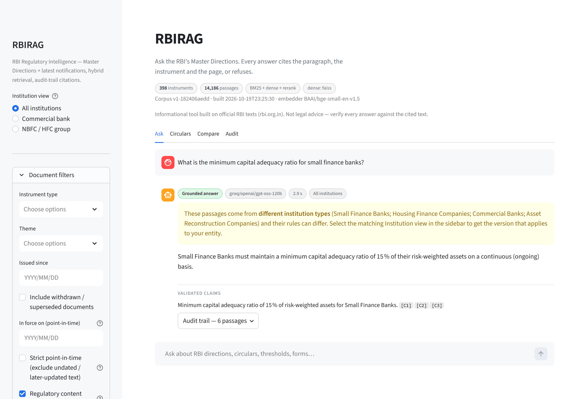
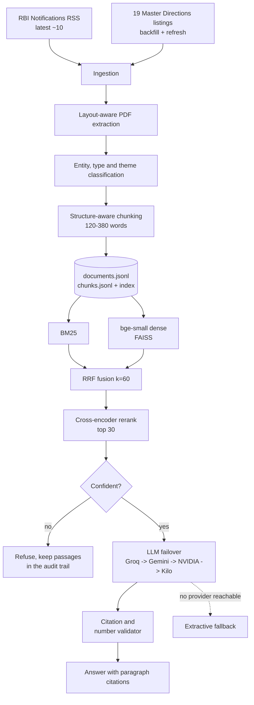

# RBIRAG

**Ask the RBI's Master Directions a question and get an answer that cites the
paragraph, the instrument and the page — or an explicit refusal.**




RBIRAG is a retrieval-augmented generation system over the Reserve Bank of
India's complete Master Directions catalogue and its latest notifications. It
polls the RBI RSS feed, backfills all 19 Master Directions listings, parses the
official PDFs layout-aware, tags every instrument by the entities it binds
(commercial bank, NBFC/HFC, co-operative bank, and so on), and answers with
hybrid retrieval and claim-level citations. The corpus and indexes ship with the
repo, so a clone runs without a crawl, an API key or a build step.

After RBI's November 2025 consolidation into entity-wise *Directions, 2025*
(~9,445 circulars withdrawn), the operative question is no longer "where is the
circular" but "which document applies to my entity, at which paragraph, as of
when". Both entity columns run off the same corpus with one toggle.

> Informational tool built on official RBI texts (rbi.org.in). Not legal advice.

## At a glance

| | |
|---|---|
| **Corpus** | 398 instruments · 14,186 passages · 16,016 pages (synced 2026-10-20) |
| **Retrieval** | BM25 (legal-identifier tokenizer) + bge-small-en-v1.5 dense (FAISS) → RRF k=60 → cross-encoder rerank |
| **Gold set** | recall@5 **96%** (96/100) · MRR **0.827** · nDCG@10 **0.859** |
| **Held-out set** | recall@5 **12/12** · MRR **0.819** |
| **Abstention** | refused **10 of 11** out-of-scope probes; **17 of 18** on a never-tuned held-out set |
| **Answers** | provider failover, claim-level citation validation, number grounding, extractive fallback |
| **Answer quality** | RAGAS faithfulness **0.913** · relevancy **0.803** · context precision **0.544** (83/100 answered) |
| **Latency** | ~65 ms retrieval, ~8–13 s with rerank on a 4-core laptop |
| **Tests** | 120 passing (`pytest tests`) |

## Quickstart

```bash
git clone https://github.com/bravo2024/rbirag.git && cd rbirag
python -m venv .venv && source .venv/bin/activate     # Windows: .venv\Scripts\activate
pip install -r requirements.txt
streamlit run app.py
```

No LLM key is required. Answers route through the anonymous **Kilo** gateway;
if every provider is down the app returns the retrieved passages with citations
(**extractive mode**). Keys for Groq, Gemini and NVIDIA Build are read from
`.env` (see `.env.example`) and simply extend the failover chain. Retrieval and
citations never depend on a model.

To rebuild the corpus from RBI instead of using the committed artifacts:

```bash
python scripts/sync.py --source both      # RSS + backfill listings
python scripts/build_index.py --full      # BM25 + dense (downloads bge-small, ~130 MB)
```

Optional extras (FAISS, the LangChain layer, Kaggle CLI, RAGAS):
`pip install -r requirements-extras.txt`.

## How it works



**Ingestion.** `rss.py` diffs the feed against persisted state, so the ~10-item
window does not lose items between polls. `backfill.py` crawls all 19 listings
(30 pages across the cross-cutting, Regulation and Supervision departments) and
resolves each view page to its consolidated PDF. `extract.py` keeps reading
order, drops running letterheads, page numbers and dot-leader TOC lines,
separates footnotes and dehyphenates; naive text dumps interleave all of that
into the body and wreck both chunking and retrieval. `chunk.py` builds the
chapter / numbered-paragraph / decimal / (a)(i) tree and packs it into 120–380
word passages without cutting a clause that has sub-clauses to split on.
`ingest.py` runs the whole pipeline under a lockfile, is idempotent per RBI page
id, and treats failures per document rather than per run. `refresh_backfill()`
re-checks each listing's "Updated as on" date and re-ingests changed pages as a
new version, flipping the old one to `superseded`.

**Retrieval.** BM25 uses a tokenizer that keeps legal identifiers whole
(`5.2.1`, `DOR.STR.REC.51/21.04.048/2024-25`, `RBI/2026-27/293`). The dense arm
is `BAAI/bge-small-en-v1.5` with query prefixing, float16 storage and exact
FAISS `IndexFlatIP` search, plus a byte-identical NumPy fallback when FAISS is
absent. Reciprocal Rank Fusion (k=60) merges the arms, a text-hash dedupe
collapses byte-identical chunks, and `ms-marco-MiniLM-L-6-v2` reranks the top
30. Filters cover institution view, instrument type, theme, issued-since,
point-in-time and withdrawn documents; cross-cutting instruments always pass the
institution filter. If the best rerank logit falls below the calibrated
threshold (+2.0), the query is refused at retrieval level and the model is never
asked.

**Answers.** The model must return strict JSON: an answer plus claim-level
citations (`[C3]`). Each claim is checked against the numbered passages, and
unresolvable claims are dropped and counted. Surviving claims are
number-grounded: every number must appear in the passage it cites, and a
mismatch is flagged in the UI. Provider failover is Groq → Gemini → NVIDIA
Build → Kilo, with model ids discovered live from each provider's `/models`
endpoint and failing models parked for 30 min (permanent), 10 min (timeout) or
60 s (rate limit). A truncated JSON reply is retried once with a doubled token
budget. With no provider reachable the same response shape is filled
extractively.

**App.** Four tabs. *Ask* is a chat over the corpus with the institution toggle
and an in-force-on date, and every answer carries its mode, serving model,
latency, validated claims and an expandable audit trail with per-passage
citation cards and retrieval ranks. *Circulars* browses every instrument with
metadata, entity and theme chips, extraction provenance and the full parsed text
page by page. *Compare* puts two instruments side by side with
paragraph-overlap highlighting (≥62% similar), useful for the bank versus NBFC
version of one mandate or a consolidation versus its amendment. *Audit* lists
every query since deployment and exports the trace as JSONL.

## Evaluation

**Retrieval.** 100 curated questions with gold document ids, covering every
entity class in the corpus — commercial banks, NBFCs, small finance and payments
banks, local-area, urban and rural co-operative banks, regional rural banks, all
India financial institutions and credit information companies. Then a
12-question held-out set authored after the defaults were frozen (gold ids
resolved from titles only, never used for tuning).

| set | n | recall@5 | MRR | nDCG@10 |
|---|---|---|---|---|
| gold | 100 | **96%** | 0.827 | 0.859 |
| gold, rerank off | 100 | 89% | 0.683 | 0.745 |
| held-out | 12 | **100%** | 0.819 | 0.866 |
| 120-question draft, answerable + amendment | 80 | 95.0% | 0.795 | 0.816 |
| same, rerank on | 80 | 92.5% | 0.812 | 0.826 |

Rerank is worth **+7 points of recall@5 and +0.14 MRR** on the 100-question set.
On the 120-question draft it is a slight loss: it rescues none of the four
misses and adds two top-5 misses of its own (both still inside top 10). The four
gold misses are sibling-topic confusions rather than label errors — a local-area
bank query for income recognition returns that bank class's investment-portfolio
direction, and an NBFC portfolio question returns the HFC omnibus direction,
which is large enough to match almost any NBFC topic. The draft labels have not
been domain-reviewed yet.

**Abstention.** The +2.0 threshold was calibrated on the gold set plus 11
negative probes, then checked once at the unchanged value on 18 new negatives
written before any score was seen.

| probe set | refused |
|---|---|
| calibration negatives (retrieval gate) | 10 / 11 |
| held-out negatives (never tuned) | **17 / 18** |
| in-scope gold questions (retrieval gate) | 0 / 100 |
| in-scope gold questions (answer layer) | 17 / 100 |

The gate catches other-regulator and off-topic questions reliably. It does not
catch RBI-flavoured questions whose topic is absent from the corpus: the
held-out miss is a press-release probe scoring +5.01, above the lowest in-scope
top passage (+3.42). Where the ranges overlap, the answer layer is the only
defence. An out-of-corpus detector is the real fix and is on the roadmap.

The 17 answer-layer refusals are a different failure: the gate never fired on
them, and 15 had the gold document at rank 1–2. The six passages retrieved from
it were the direction's front matter — title, applicability, definitions —
without the operative paragraphs, so the model refused instead of guessing.
Document-level recall is therefore not the whole story: passage selection inside
thin or heavily structured directions is the next retrieval fix.

**Answers.** RAGAS over the 100 gold questions, scoring faithfulness, answer
relevancy and LLM-judged context precision without reference. 83 answers
reached the judge; the other 17 were refused by the answer layer, as described
above.

| metric | scored | mean |
|---|---|---|
| faithfulness | 80 / 83 | 0.913 |
| answer relevancy | 83 / 83 | 0.803 |
| context precision | 83 / 83 | 0.544 |

Context precision is the weak metric. The reranker puts the right document into
context 95 times out of 100, but six passages per answer still carry a lot of
near-miss text from sibling directions, and the judge scores most of those
passages as not useful. That is the same passage-selection weakness behind the
17 refusals: document recall is high, passage precision is not.

Free-tier serving is a lottery, so these describe what the product achieved on
free keys in one window, not a stable benchmark. The requested answer pin
served 54 of 100 answers and the requested judge pin served 31 of 917 judge
calls; the rest fell back to Gemini, Nemotron and one pooled free model. Each
artifact records the serving provider and model for every answer and every
judge call. The first agreement figure (r = 0.999) was withdrawn after tracing
it to a cache collision: the second judge was reading the first judge's cached
reply. The cache is now keyed per pinned model and `--strict-pin` forbids live
fallback. The strict rerun on the earlier 23-question set is the first agreement
number computed over genuinely different served models — r = 0.322 (n = 12),
which is the honest size of that corroboration. It has not been re-measured at
n = 100.

The mechanical validators and the held-out sets are the anti-overclaiming
anchors: citation resolution and number grounding do not depend on a judge, and
the held-out queries were never used for tuning.

## Limitations

- **The corpus is forward-only.** For most Directions the held text is the
  current consolidation, so a pre-amendment `as_of` query can only return
  documents whose text has not changed since then. Strict mode makes that
  visible by returning little rather than guessing.
- **The abstain threshold is a first line, not a guarantee.** In-scope and
  out-of-scope score ranges overlap, and behaviour in the overlap depends on
  which free model is serving.
- **Amendment links are pointers, not consolidation.** Notices are matched to
  their parent Directions by title similarity (6/6 correct today) and shown on
  citation cards, but amended paragraphs are not merged into the parent text.
- **Near-identical entity versions are not merged.** The consolidation ships up
  to ~10 copies of the same policy; the institution toggle filters to your
  column, and the app warns when retrieved passages span more than one entity
  type, but the text-hash dedupe only collapses byte-identical chunks.
- **Rerank dominates latency.** ~8–13 s per query on four cores under real
  load; `REGINTEL_RERANK_DEPTH=20` or disabling rerank trades recall for speed.
  int8 quantization and ONNX export were measured as no-win or blocked by a
  dependency conflict.
- **~43% of listings carry no "Updated as on" date**, so in-place change
  detection falls back to nothing for those pages until a content-hash check
  lands.

## Roadmap

- Out-of-regulator query detector (SEBI, IRDAI, PFRDA, FCA) so refusal does not
  depend on the answer model.
- Domain-tuned encoders and rerankers from the RegRAG Kaggle fine-tunes, behind
  the existing `REGINTEL_EMBED` / `REGINTEL_RERANK` switches.
- Obligation extraction: who must do what, by when, into a structured register
  per institution.
- Cross-entity gap analysis: which clauses of a bank mandate have no NBFC
  counterpart.
- Amendment-aware consolidation with per-clause provenance.
- Content-hash refresh for listings without an "Updated as on" date.

## Repository layout

```
app.py                 Streamlit UI: Ask / Circulars / Compare / Audit
regintel/              ingestion, classification, chunking, retrieval, answers
  index/               BM25, dense (FAISS), RRF fusion, cross-encoder rerank
  lc/                  optional LangChain retriever and LCEL chain
scripts/               sync, index build, evaluations, Kaggle GPU build
evals/                 gold set, held-out set, 120-question draft set, results
data/                  committed corpus and indexes
tests/                 120 offline tests
```

`scripts/eval_retrieval.py`, `eval_v2.py`, `eval_abstention.py` and
`eval_answers.py` reproduce every number above; each writes a JSON artifact to
`evals/results/`. The Python package is named `regintel` (the project's original
working name); `RBIRAG` is the product name used in the UI and documentation.

## License

MIT — see [LICENSE](LICENSE).
